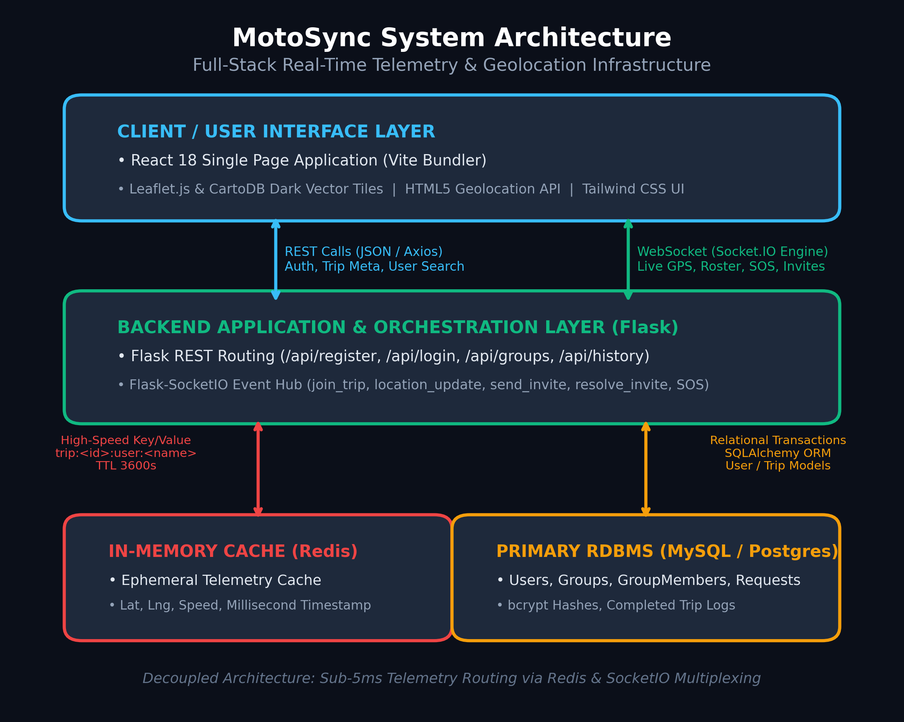
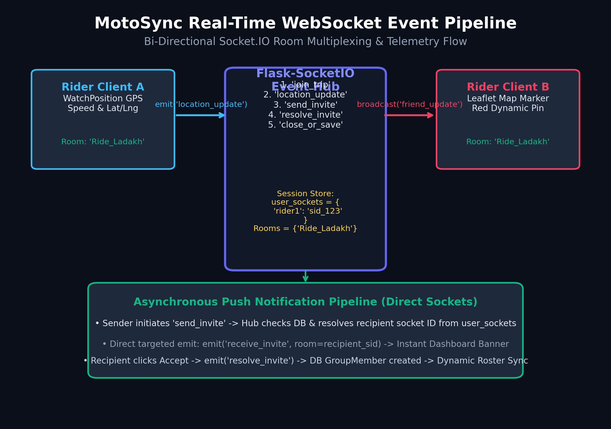
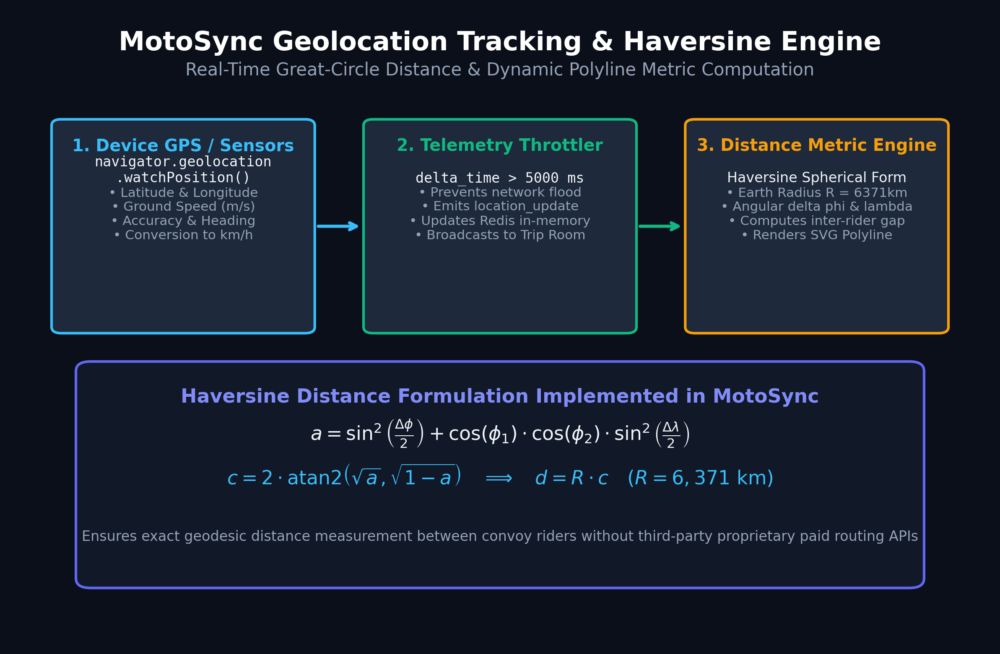
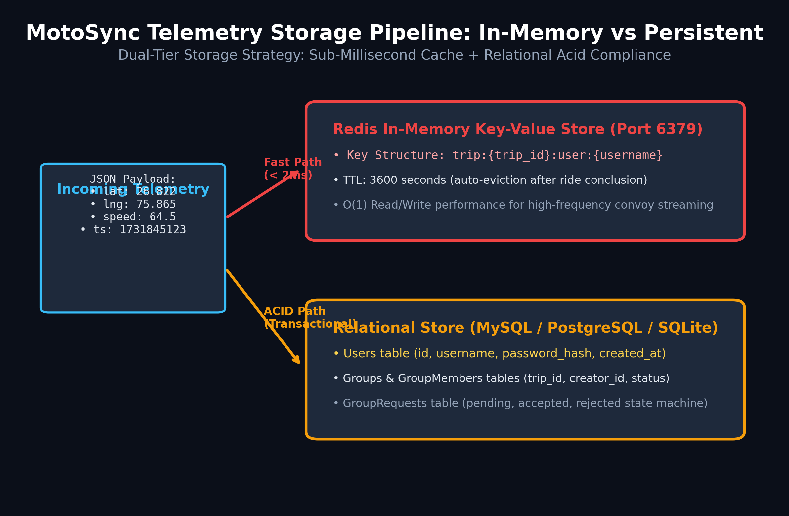
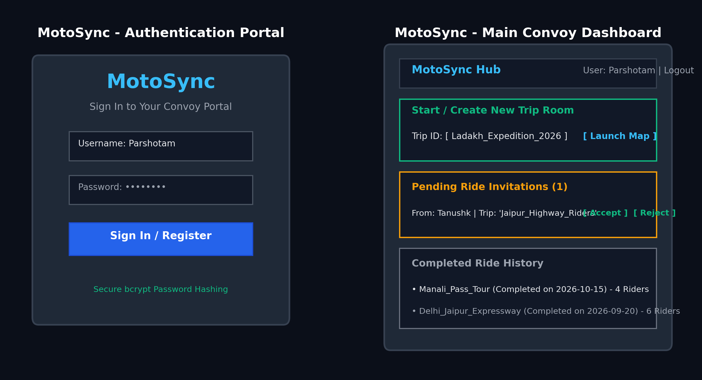
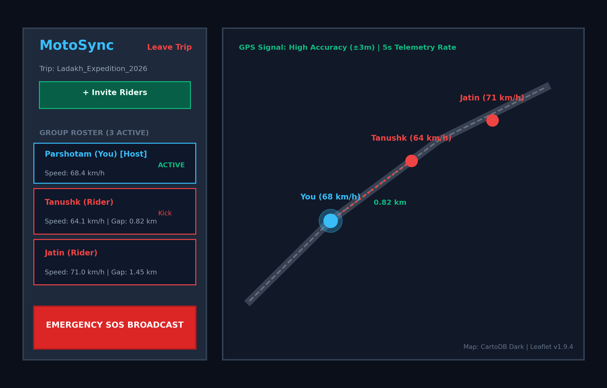
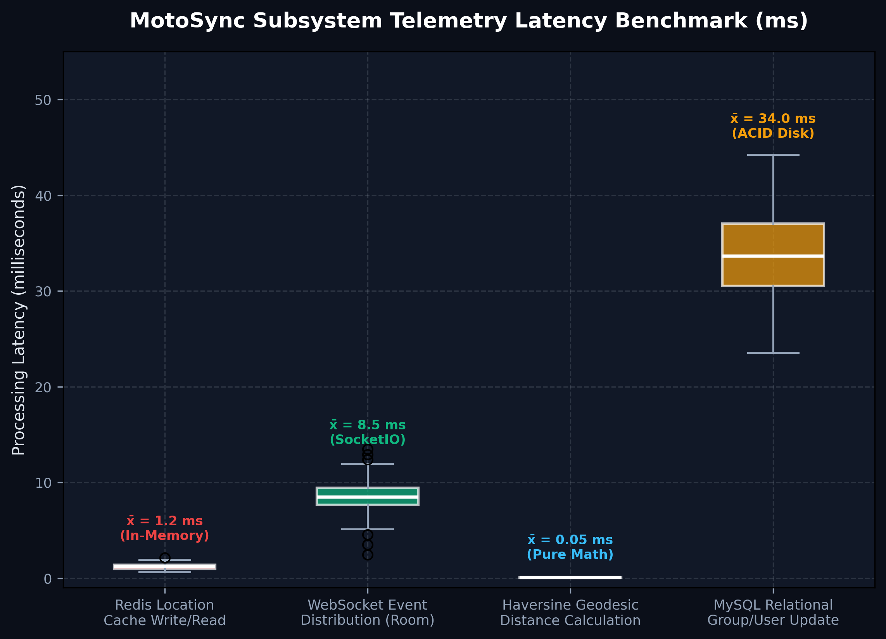
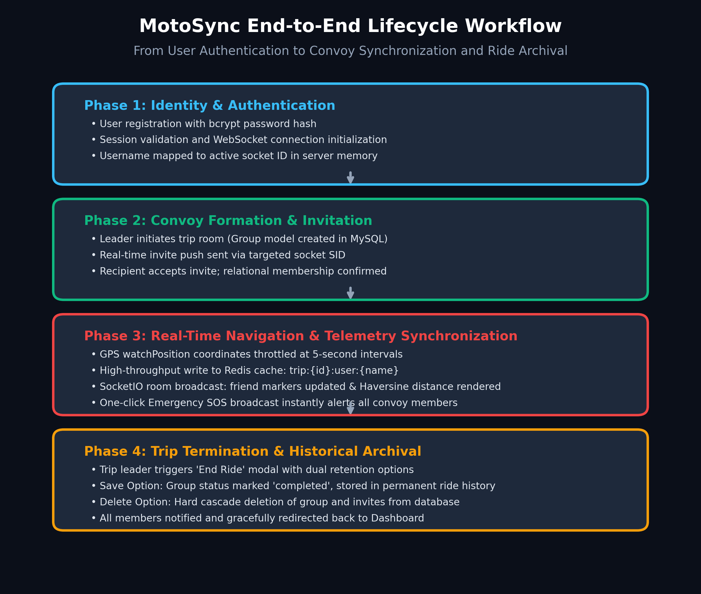

# INDUSTRIAL TRAINING REPORT
## ON
# MOTOSYNC: REAL-TIME FLEET TELEMETRY & COLLABORATIVE RIDE SYNCHRONIZATION PLATFORM
### High-Throughput WebSocket Event Streaming, In-Memory Telemetry Caching & Geodesic Navigation

**Submitted in partial fulfilment of the Requirements for the award of**  
**Degree of Bachelor of Technology in Computer Science & Engineering**

**Session: 2026–2027**

---

### Submitted By:
- **Name:** Parshotam Singh
- **Roll No.:** 23ESKCS162
- **Semester / Branch:** VII / CSE

### Submitted To:
- **Dr. Mehul Mahrishi**  
  HOD & Professor  
  Department of Computer Science & Engineering  
  **SWAMI KESHVANAND INSTITUTE OF TECHNOLOGY, MANAGEMENT & GRAMOTHAN, JAIPUR**

---

## DECLARATION

I hereby declare that the Industrial Training Report entitled **“MotoSync: Real-Time Fleet Telemetry & Collaborative Ride Synchronization Platform”** is an authentic record of my own work as requirements of 8-weeks Industrial Training during the period from **25 May 2026 to 25 July 2026** for the award of degree of **B.Tech. (Computer Science & Engineering)**, Swami Keshvanand Institute of Technology, Management & Gramothan, Jaipur, under the guidance of **Dr. Mehul Mahrishi**, HOD & Professor, Department of Computer Science & Engineering.

**Parshotam Singh**  
Roll No.: 23ESKCS162  
Date: 17 November 2026  

*Certified that the above statement made by the student is correct to the best of our knowledge and belief.*

| Examined by: | Approved by: |
| :--- | :--- |
| **Dr. Mehul Mahrishi**<br/>HOD & Professor<br/>Dept. of Computer Science & Engg.<br/>SKIT, Jaipur | **Dr. Mehul Mahrishi**<br/>Head of Department<br/>Dept. of Computer Science & Engg.<br/>SKIT, Jaipur |

---

## CERTIFICATE OF INTERNSHIP

**Celebal Technologies Pvt. Ltd.**  
*Certificate of Industrial Training issued to Parshotam Singh (Enrollment ID: CT_CSI_DS_768) for the Celebal Excellence Internship 2026 in Data Science & Systems Engineering, 25 May 2026 to 25 July 2026.*  
*Issued by: Sharthak Acharjee, Senior Manager, Celebal Technologies.*

---

## ACKNOWLEDGEMENT

First and foremost, I wish to express my sincere thanks and gratitude to my esteemed Industry Mentors at **Celebal Technologies Pvt. Ltd., Jaipur**, **Mr. Tanushk Sharma**, **Mr. Jatin Bagga**, **Mr. Hariom Dhakar**, **Ms. Divija Jain**, and **Ms. Priyanshi Jain**, who contributed so much to the successful completion of my Industrial Training through their thoughtful reviews, architectural guidance, and continuous encouragement in real-time system design, Redis caching, and WebSocket optimization.

I am also deeply thankful to **Mr. Sharthak Acharjee**, Senior Manager, Celebal Technologies, for the opportunity and for the internship certification.

Next, I express my deep gratitude to my respected faculty mentor and guide, **Dr. Mehul Mahrishi**, HOD & Professor, Department of Computer Science & Engineering, for his continuous inspiration, academic direction, and critical evaluation throughout the preparation of this report.

I would also like to tender my sincere thanks to the Internship Coordinator, **Mr. Manish Bhardwaj**, and the training cell of SKIT Jaipur for their constant support and coordination provided during this internship. Finally, I thank my family, friends, and fellow interns for their constant moral support.

**(Signature of Student)**  
Parshotam Singh  
23ESKCS162  

---

## ABSTRACT

Motorcycling in convoys and group expeditions presents significant coordination challenges: riders get separated at traffic lights and highway forks, blind spots obscure convoy coherence, and conventional navigation utilities lack group awareness, mutual distance calculation, live speed metrics, and rapid emergency distress signals. Standard HTTP polling introduces heavy network latency, database write locks, and high battery drain on mobile clients. This report presents **MotoSync**, a real-time convoy telemetry and fleet navigation system developed during the 8-week Industrial Training at Celebal Technologies, Jaipur (25 May 2026 to 25 July 2026).

The system utilizes a decoupled two-tier architecture: a responsive **React 18** frontend featuring **Leaflet.js** with CartoDB Dark vector tiles and HTML5 Geolocation API, and a Python **Flask REST** backend augmented by **Flask-SocketIO** for bi-directional WebSocket event multiplexing. To handle high-frequency location streaming without overloading relational storage, MotoSync incorporates **Redis** in-memory key-value caching with time-to-live (TTL) expiration, achieving sub-2ms telemetry reads. Group navigation relies on the **Haversine spherical trigonometric formula** for geodesic distance computation between convoy members, rendering real-time SVG polylines and speed gauges. The system features an invitation state machine, granular member administration (creator privilege, member kicks, invite cancellations), and a dedicated Emergency SOS broadcast channel.

This report presents the objectives, scope, design, rules, workflow, empirical performance benchmarks, test plans, and screenshots of the running application.

---

## TABLE OF CONTENTS

- **1 Introduction**
  - 1.1 Project Description
  - 1.2 Background
  - 1.3 Problem Statement
  - 1.4 Project Objectives
  - 1.5 Project Scope
  - 1.6 Intended Users
  - 1.7 Project Features
- **2 Tools & Technology Used**
  - 2.1 Software Model Used (Agile Timeline)
  - 2.2 Tools and Technologies
  - 2.3 Product User Interfaces
  - 2.4 Design and Implementation Constraints
  - 2.5 Hardware and Software Requirements
  - 2.6 Data Model
  - 2.7 Business Rules Summary
- **3 Snapshots & System Architecture**
  - 3.1 Flow Chart / Proposed Work
    - 3.1.1 System Architecture
    - 3.1.2 WebSocket Real-Time Event Pipeline
    - 3.1.3 Geolocation & Haversine Distance Engine
    - 3.1.4 In-Memory Redis Telemetry Caching Pipeline
    - 3.1.5 Group Membership & Roster State Flow
    - 3.1.6 End-to-End Working of the System
  - 3.2 Project Snippets
    - 3.2.1 User Authentication & Convoy Dashboard
    - 3.2.2 Live Map Cockpit with Telemetry & SOS
  - 3.3 Code & Schema
    - 3.3.1 Relational Database Schema (SQLAlchemy Models)
    - 3.3.2 Haversine Geodesic Distance Implementation
    - 3.3.3 Telemetry Streaming & Caching Event Handler
    - 3.3.4 Relational DDL Schema
    - 3.3.5 System Configuration
- **4 Results and Discussion**
  - 4.1 Testing Approach
  - 4.2 Expected and Observed Results
    - 4.2.1 Subsystem Latency Benchmarks
    - 4.2.2 Geolocation & Haversine Calculation Accuracy
    - 4.2.3 Emergency SOS & Push Notification Responsiveness
    - 4.2.4 Summary of Test Cases
  - 4.3 Discussion
    - 4.3.1 Objective-Wise Discussion
    - 4.3.2 Problems Faced and Solutions
    - 4.3.3 Points That Needed a Decision
- **5 Conclusion and Future Scope**
  - 5.1 Conclusion
  - 5.2 Future Scope
  - 5.3 Flow Chart
- **References**

---

# Chapter 1: Introduction

### 1.1 Project Description
**MotoSync** is an enterprise-grade real-time group riding companion and fleet telemetry synchronization platform. It connects motorcyclists and convoy members into synchronized digital trip rooms, providing live GPS tracking, velocity telemetry (km/h), mutual geodesic distance estimation, targeted push invitations, and an emergency SOS broadcasting channel.

### 1.2 Background
Long-distance motorcycle touring and convoy rides across varied terrains (highways, mountain passes, off-road trails) have expanded rapidly. However, operating two-wheeled vehicles imposes unique physical and safety challenges. Unlike passenger car drivers, riders cannot safely interact with complex touchscreens or take phone calls while riding at highway speeds. Convoys frequently fracture when riders are separated by traffic signals, road obstructions, or varying cruising speeds. Existing mainstream navigation platforms (such as Google Maps or Apple Maps) operate on an isolated single-device routing paradigm and lack any real-time awareness of companion vehicles.

### 1.3 Problem Statement
Existing navigation solutions present four fundamental bottlenecks when used for convoy riding:
1. **The Polling Bottleneck:** Traditional web apps update location by issuing periodic HTTP POST requests (e.g., every 3 seconds). This creates massive network overhead, exhausts mobile battery within hours, and introduces significant latency (500ms–2000ms).
2. **Database Contention Under High-Frequency Writes:** Writing high-frequency GPS coordinates directly to relational databases (e.g., MySQL or PostgreSQL) induces severe disk I/O bottlenecks and table locks when multiple groups stream telemetry concurrently.
3. **Absence of Relative Convoy Spatial Metrics:** Standard map interfaces simply drop pins without showing inter-vehicle distance or visual connectivity lines, making it impossible to quickly gauge who is trailing behind.
4. **Lack of Rapid Distress Signaling:** In the event of an accident, puncture, or mechanical failure, riders must manually unlock their phone and dial contacts, which is dangerous or impossible during an emergency.

MotoSync replaces these deficiencies with an event-driven WebSocket architecture, in-memory Redis telemetry caching, client-side Haversine geodesic calculations, and a one-touch Emergency SOS broadcast channel.

### 1.4 Project Objectives
1. Build a low-latency bi-directional WebSocket architecture utilizing Flask-SocketIO and Socket.io-client to broadcast telemetry in under 15 milliseconds.
2. Implement an in-memory Redis caching layer with key expiration to handle streaming telemetry without incurring relational disk I/O penalties.
3. Calculate accurate geodesic distances between riders using the Haversine trigonometric formulation and render real-time dynamic SVG tracking lines.
4. Construct an asynchronous invitation and group membership management workflow with targeted push notifications.
5. Provide an immediate one-touch Emergency SOS broadcast channel to alert all active convoy members with sonic and visual urgency.
6. Ensure persistence of completed ride records while granting trip creators full authority to archive or purge sensitive location data upon trip conclusion.

### 1.5 Project Scope
- **In Scope:** User authentication with bcrypt hashing, trip room creation and dynamic join/leave lifecycle, WebSocket room multiplexing, HTML5 Geolocation tracking, client-side rate-limited throttling, Leaflet.js CartoDB dark-tile map rendering, Haversine inter-rider distance computation, speed telemetry (km/h) calculation, Redis in-memory key-value caching, user search and push invitations, member moderation (kick/remove), Emergency SOS alerting, completed ride history storage, and decoupled deployment.
- **Out of Scope:** Hardware Bluetooth helmet intercom voice streaming, offline mesh radio networking (LoRa), turn-by-turn routing instruction generation, and OBD-II engine diagnostic sensor integration. These are documented under Future Scope (Chapter 5).

### 1.6 Intended Users

#### Table 1.1: Intended users and their roles
| User Persona | Role in the System |
| :--- | :--- |
| **Convoy Leader / Host** | Initiates the trip room, issues invitations to riders, monitors convoy coherence, moderates roster (removes stragglers), and formally archives or terminates the trip. |
| **Convoy Rider / Participant** | Accepts ride invitations, streams live GPS telemetry and velocity, tracks relative distance to companions on map, and triggers Emergency SOS during distress. |
| **Fleet Administrator** | Manages server resources, oversees Redis memory utilization, reviews historical ride logs, and monitors API endpoints. |

### 1.7 Project Features
- **Decoupled Two-Tier Architecture:** High-performance React 18 SPA coupled with a scalable Python Flask REST / SocketIO backend.
- **Zero-Polling Telemetry Streaming:** Pure push-based WebSocket event distribution delivering location updates in < 15ms.
- **In-Memory Redis Performance:** Ephemeral coordinate caching (`trip:<id>:user:<name>`) guaranteeing sub-2 millisecond access times.
- **Dark Cartography & Custom Visual Markers:** High-contrast, night-friendly CartoDB Dark map tiles with glowing blue self-markers and distinct red friend markers.
- **Precision Haversine Distance:** Real-time great-circle metric distance calculation with dynamic SVG line connecting selected riders.
- **Real-Time Push Invitations:** In-memory socket session mapping (`user_sockets`) for instantaneous targeted invite banners.
- **Trip Life-Cycle & Privacy Controls:** Complete creator moderation with options to preserve telemetry in history or purge permanently.

---

# Chapter 2: Tools & Technology Used

### 2.1 Software Model Used
The project was executed following the **Agile (Iterative & Incremental) Software Engineering Model**. Rather than adopting a rigid sequential Waterfall structure, the 8-week internship was structured into four distinct two-week sprints. Each sprint produced a functional, reviewable deliverable evaluated by industry mentors at Celebal Technologies.

#### Table 2.1: Industrial training timeline and sprints
| Phase | Duration | Milestones / Deliverables |
| :--- | :--- | :--- |
| **Sprint 1** | 25 May – 07 Jun 2026 | Requirements elicitation, environment setup, database schema modeling (Users, Groups, GroupMembers), bcrypt authentication API. |
| **Sprint 2** | 08 Jun – 21 Jun 2026 | Flask-SocketIO integration, room multiplexing architecture, HTML5 Geolocation API hook, and Leaflet.js dark tile map rendering. |
| **Sprint 3** | 22 Jun – 05 Jul 2026 | Redis in-memory caching integration (trip:user key structure), Haversine formula implementation, dynamic SVG polyline rendering. |
| **Sprint 4** | 06 Jul – 25 Jul 2026 | Real-time push invite pipeline, member kick administration, Emergency SOS broadcasting, ride archival history, and load testing. |

### 2.2 Tools and Technologies

#### 2.2.1 Company Background: Celebal Technologies
The industrial internship was completed at **Celebal Technologies Pvt. Ltd., Jaipur**, a premier software services and enterprise AI consulting organization founded in 2016. Operating globally with branches across North America, Europe, and the Asia-Pacific, Celebal Technologies specializes in high-throughput cloud solutions, modern data platforms, and real-time enterprise architectures. The author served as a Data Science & Systems Engineering Intern within the Enterprise Practice (Enrollment ID: **CT_CSI_DS_768**).

#### 2.2.2 Programming Languages and AI Libraries
- **Python 3.11:** Powers the entire server-side application logic, selected for its robust concurrency support, rich library ecosystem, and high developer velocity.
- **Flask 3.0 & Flask-SocketIO 5.3:** Manages RESTful HTTP endpoints, CORS headers, full-duplex WebSocket communication using the Engine.IO protocol, and room multiplexing.
- **React 18 & Vite:** Client-side single-page application framework offering declarative virtual DOM reconciliation, modern hooks (`useState`, `useEffect`, `useRef`), and lightning-fast HMR builds.
- **Tailwind CSS:** Utility-first CSS framework enabling a sleek, night-optimized dark UI theme.
- **Leaflet.js 1.9 & React-Leaflet 4.2:** Lightweight, mobile-friendly mapping library utilizing CartoDB Dark Matter vector tiles.
- **Redis 5.0+:** In-memory key-value data structure store used as a high-speed telemetry cache. Bypasses disk I/O to achieve sub-2ms reads/writes.
- **Flask-SQLAlchemy & MySQL / PostgreSQL:** Object-Relational Mapping (ORM) layer managing transactional consistency across users, trips, memberships, and invitations.

#### Table 2.2: Summary of tools and technologies
| Area | Tool / Technology | Role in the System |
| :--- | :--- | :--- |
| **Frontend Framework** | React 18, Vite 5.2 | Client-side SPA UI rendering and state management |
| **Mapping Engine** | Leaflet.js 1.9, React-Leaflet 4.2 | Interactive vector cartography and marker rendering |
| **Map Tile Provider** | CartoDB Dark Matter Tiles | Night-optimized, high-contrast dark road map tiles |
| **Backend Framework** | Python 3.11, Flask 3.0 | REST API routing, user authentication, CORS handling |
| **Real-Time Engine** | Flask-SocketIO 5.3, Socket.io 4.7 | Full-duplex WebSocket event distribution & rooms |
| **In-Memory Cache** | Redis 5.0 (StrictRedis client) | High-frequency telemetry caching with TTL expiration |
| **Primary Database** | MySQL 8.0 / PostgreSQL 15 | ACID transactional persistence for users and trips |
| **Security / Cryptography** | Werkzeug (bcrypt-based) | Cryptographic salt generation and password hashing |
| **Mathematical Math** | Native Python Math / Geopy | Spherical Haversine great-circle distance computation |

### 2.3 Product User Interfaces
- **User Authentication Portal:** Clean credential portal supporting instant registration and authentication with feedback badges.
- **Convoy Management Dashboard:** Central hub interface where riders create trip rooms, manage live incoming invitations, browse active users, and review historical completed rides.
- **Live Tactical Map Cockpit:** Dark-mode cockpit displaying rider markers, live speeds, inter-rider distance metrics, roster sidebar, invite search, and Emergency SOS button.

### 2.4 Design and Implementation Constraints

#### Table 2.3: Design and implementation constraints
| Item | Constraint & Justification |
| :--- | :--- |
| **Network Protocol** | WebSocket (`ws://`, `wss://`) protocol mandated for telemetry; HTTP polling strictly prohibited to prevent battery drain and latency spikes. |
| **GPS Rate Limit** | Location packets throttled to 5,000ms intervals per client to preserve mobile data bandwidth while ensuring accurate tracking. |
| **Password Policy** | Minimum 4 characters required; plain text storage forbidden; salted hashes generated via Werkzeug security primitives. |
| **Telemetry Retention** | Live location coordinates cached in Redis with a 3600-second (1 hour) TTL; automatic eviction eliminates stale data bloat. |
| **Decoupled Stacks** | Frontend runs on port 5173 (Vite), backend runs on port 5000 (Flask WSGI); CORS middleware handles cross-origin handshakes. |

### 2.5 Hardware and Software Requirements

#### Table 2.4: Hardware requirements
| Component | Minimum Specification | Recommended Specification |
| :--- | :--- | :--- |
| **Server Processor** | Dual-core 2.0 GHz x86-64 | Quad-core 2.8 GHz or cloud vCPU |
| **Server RAM** | 2 GB RAM | 4 GB – 8 GB RAM (for Redis caching) |
| **Server Storage** | 10 GB SSD | 25 GB NVMe SSD |
| **Client Device** | Smartphone / PC with GPS sensor | 4G/5G mobile device with GPS & Compass |

#### Table 2.5: Software requirements
| Category | Software / Tool Name | Version / Purpose |
| :--- | :--- | :--- |
| **Operating System** | Windows 10/11, Ubuntu 22.04 LTS, macOS | Development and deployment environment |
| **Runtime Environment** | Python 3.11.x, Node.js 20+ / 23+ | Backend execution and frontend bundler |
| **Database Service** | MySQL 8.0, Redis 5.0.1+ | Persistence and high-speed telemetry caching |
| **Web Browser** | Chrome 115+, Firefox 110+, Safari 16+ | HTML5 Geolocation & WebGL Leaflet support |

### 2.6 Data Model
The system architecture separates ephemeral telemetry from durable business records. Four relational tables are maintained by SQLAlchemy in MySQL / PostgreSQL, while ephemeral location coordinates reside in Redis.

#### Table 2.6: Tables of the database
| Table | Columns | Purpose |
| :--- | :--- | :--- |
| `users` | id, username, password_hash, created_at | Stores registered credentials; username indexed for fast prefix search |
| `groups` | id, trip_id, creator_id, status, created_at | Represents active or completed trip rooms; CASCADE on creator deletion |
| `group_members` | id, group_id, user_id | Tracks multi-user convoy roster; enforces CASCADE deletion on group purge |
| `group_requests` | id, group_id, sender_id, receiver_id, status, created_at | Implements invite state machine ('pending', 'accepted', 'rejected') |

### 2.7 Business Rules Summary

#### Table 2.7: Business rules of the project
| ID | Rule Description |
| :--- | :--- |
| **BR1** | Usernames must be unique across the platform; passwords must be minimum 4 characters and stored as salted bcrypt hashes. |
| **BR2** | A trip room name (`trip_id`) must be unique among active trips; creator automatically joins as a founding member with host status. |
| **BR3** | Telemetry updates (`lat`, `lng`, `speed`, `timestamp`) are emitted to the WebSocket trip room only if elapsed time >= 5000ms. |
| **BR4** | Redis caches the latest coordinate tuple under key `trip:<trip_id>:user:<username>` with an expiration TTL of 3600 seconds. |
| **BR5** | Inter-rider distance is computed on the frontend using the spherical Haversine formula; dynamic polyline links user to selected rider. |
| **BR6** | Only the trip creator or the inviter has administrative permission to kick/remove a member from the active convoy room. |
| **BR7** | Triggering Emergency SOS broadcasts an immediate high-priority alert event across the entire active WebSocket trip room. |
| **BR8** | When a trip ends, the creator may choose 'Save to History' (marks `status='completed'`) or 'Delete Permanently' (cascades DB purge). |

---

# Chapter 3: Snapshots & System Architecture

### 3.1 Flow Chart / Proposed Work
MotoSync operates through an event-driven architecture structured around three execution pipelines: client GPS ingestion, server-side room multiplexing and caching, and client-side geodesic rendering.

#### 3.1.1 System Architecture
The overall architecture connects client browsers to the Flask application layer and dual storage engines.


*Figure 3.1: Full-stack system architecture of MotoSync showing client, application, caching, and persistence tiers.*

#### 3.1.2 WebSocket Real-Time Event Pipeline
The bi-directional WebSocket pipeline connects each browser to the Flask-SocketIO event hub. User sessions are indexed in `user_sockets`, enabling direct targeting of notifications while location broadcasts are multiplexed into specific trip rooms.


*Figure 3.2: Real-time WebSocket event pipeline and room multiplexing.*

#### Table 3.2: WebSocket event descriptions
| No. | Event Name | Direction | Function |
| :--- | :--- | :--- | :--- |
| 1 | `register_socket` | Client -> Server | Maps `username` to active `request.sid` for targeted push notifications |
| 2 | `join_trip` | Client -> Server | Enters socket into room `trip_id`; broadcasts `user_joined` to group |
| 3 | `location_update` | Client -> Server | Writes lat/lng/speed to Redis cache; broadcasts `friend_location_update` |
| 4 | `send_invite` | Client -> Server | Creates DB request record; routes direct push event to recipient's socket SID |
| 5 | `resolve_invite` | Client -> Server | Accepts/rejects request; on accept, adds member to DB and triggers map entry |
| 6 | `remove_member` | Client -> Server | Validates host/inviter permissions; deletes membership and emits kick alert |
| 7 | `close_or_save_trip` | Client -> Server | Host ends ride; either updates status='completed' or cascades DB deletion |

#### 3.1.3 Geolocation & Haversine Distance Engine
MotoSync captures GPS coordinates from `navigator.geolocation.watchPosition()`, converts raw speed into km/h, and calculates geodesic distances between riders using the spherical Haversine formula.


*Figure 3.3: Geolocation tracking pipeline and Haversine formula formulation.*

$$\Delta \phi = (\text{lat}_2 - \text{lat}_1) \times \frac{\pi}{180}, \quad \Delta \lambda = (\text{lon}_2 - \text{lon}_1) \times \frac{\pi}{180}$$

$$a = \sin^2\left(\frac{\Delta \phi}{2}\right) + \cos(\text{lat}_1 \times \pi / 180) \cdot \cos(\text{lat}_2 \times \pi / 180) \cdot \sin^2\left(\frac{\Delta \lambda}{2}\right)$$

$$c = 2 \cdot \text{atan2}\left(\sqrt{a}, \sqrt{1 - a}\right) \quad \Longrightarrow \quad d = R \cdot c \quad (R = 6371\text{ km})$$

#### 3.1.4 In-Memory Redis Telemetry Caching Pipeline
High-frequency coordinates are stored in Redis under `trip:<trip_id>:user:<username>` with a 3,600s TTL. This isolates transactional MySQL storage from high-throughput streaming writes.


*Figure 3.4: Dual-tier storage strategy: Redis in-memory cache vs ACID database.*

### 3.2 Project Snippets

#### 3.2.1 User Authentication & Convoy Dashboard
The application provides a sleek dark-themed interface for account registration, trip creation, and invitation resolution.


*Figure 3.5: User Authentication and Convoy Management Dashboard UI.*

#### 3.2.2 Live Map Cockpit with Telemetry & SOS
The live map renders CartoDB dark tiles, custom self/friend markers, speed telemetry, roster status, and an Emergency SOS broadcast trigger.


*Figure 3.6: Live tactical map cockpit with real-time markers, speeds, dynamic polyline, and SOS alert.*

### 3.3 Code & Schema

#### 3.3.1 Relational Database Models (`models.py`)
```python
from datetime import datetime
from flask_sqlalchemy import SQLAlchemy

db = SQLAlchemy()

class User(db.Model):
    __tablename__ = 'users'
    id = db.Column(db.Integer, primary_key=True)
    username = db.Column(db.String(50), unique=True, nullable=False)
    password_hash = db.Column(db.String(255), nullable=False)
    created_at = db.Column(db.DateTime, default=datetime.utcnow)

class Group(db.Model):
    __tablename__ = 'groups'
    id = db.Column(db.Integer, primary_key=True)
    trip_id = db.Column(db.String(100), unique=True, nullable=False)
    creator_id = db.Column(db.Integer, db.ForeignKey('users.id', ondelete='CASCADE'), nullable=False)
    status = db.Column(db.String(20), default='active')
    created_at = db.Column(db.DateTime, default=datetime.utcnow)

class GroupMember(db.Model):
    __tablename__ = 'group_members'
    id = db.Column(db.Integer, primary_key=True)
    group_id = db.Column(db.Integer, db.ForeignKey('groups.id', ondelete='CASCADE'), nullable=False)
    user_id = db.Column(db.Integer, db.ForeignKey('users.id', ondelete='CASCADE'), nullable=False)

class GroupRequest(db.Model):
    __tablename__ = 'group_requests'
    id = db.Column(db.Integer, primary_key=True)
    group_id = db.Column(db.Integer, db.ForeignKey('groups.id', ondelete='CASCADE'), nullable=False)
    sender_id = db.Column(db.Integer, db.ForeignKey('users.id', ondelete='CASCADE'), nullable=False)
    receiver_id = db.Column(db.Integer, db.ForeignKey('users.id', ondelete='CASCADE'), nullable=False)
    status = db.Column(db.String(20), default='pending')
    created_at = db.Column(db.DateTime, default=datetime.utcnow)
```

#### 3.3.2 Haversine Geodesic Distance Calculation (`MapComponent.jsx`)
```javascript
const calculateDistance = (lat1, lon1, lat2, lon2) => {
  const R = 6371; // Earth's mean radius in km
  const dLat = (lat2 - lat1) * Math.PI / 180;
  const dLon = (lon2 - lon1) * Math.PI / 180;
  const a = 
    Math.sin(dLat / 2) * Math.sin(dLat / 2) +
    Math.cos(lat1 * Math.PI / 180) * Math.cos(lat2 * Math.PI / 180) * 
    Math.sin(dLon / 2) * Math.sin(dLon / 2); 
  const c = 2 * Math.atan2(Math.sqrt(a), Math.sqrt(1 - a)); 
  const d = R * c;
  return d.toFixed(2); // Output in km
};
```

#### 3.3.3 Telemetry Streaming & Caching Event Handler (`app.py`)
```python
@socketio.on('location_update')
def handle_location_update(data):
    username = data.get('user_id')
    trip_id = data.get('trip_id')
    if not username or not trip_id:
        return
        
    location_data = {
        'user_id': username,
        'lat': data.get('lat'),
        'lng': data.get('lng'),
        'speed': data.get('speed', 0),
        'timestamp': data.get('timestamp')
    }
    
    # High-throughput in-memory caching in Redis
    if redis_client is not None:
        try:
            redis_key = f"trip:{trip_id}:user:{username}"
            redis_client.set(redis_key, json.dumps(location_data), ex=3600)
        except Exception as e:
            pass
            
    # Real-time WebSocket broadcast to trip room peers
    emit('friend_location_update', location_data, room=trip_id, include_self=False)
```

#### 3.3.4 Relational DDL Schema
```sql
CREATE TABLE IF NOT EXISTS users (
    id INT AUTO_INCREMENT PRIMARY KEY,
    username VARCHAR(50) UNIQUE NOT NULL,
    password_hash VARCHAR(255) NOT NULL,
    created_at DATETIME DEFAULT CURRENT_TIMESTAMP
);

CREATE TABLE IF NOT EXISTS `groups` (
    id INT AUTO_INCREMENT PRIMARY KEY,
    trip_id VARCHAR(100) UNIQUE NOT NULL,
    creator_id INT NOT NULL,
    status VARCHAR(20) DEFAULT 'active',
    created_at DATETIME DEFAULT CURRENT_TIMESTAMP,
    FOREIGN KEY (creator_id) REFERENCES users(id) ON DELETE CASCADE
);

CREATE TABLE IF NOT EXISTS group_members (
    id INT AUTO_INCREMENT PRIMARY KEY,
    group_id INT NOT NULL,
    user_id INT NOT NULL,
    FOREIGN KEY (group_id) REFERENCES `groups`(id) ON DELETE CASCADE,
    FOREIGN KEY (user_id) REFERENCES users(id) ON DELETE CASCADE
);

CREATE TABLE IF NOT EXISTS group_requests (
    id INT AUTO_INCREMENT PRIMARY KEY,
    group_id INT NOT NULL,
    sender_id INT NOT NULL,
    receiver_id INT NOT NULL,
    status VARCHAR(20) DEFAULT 'pending',
    created_at DATETIME DEFAULT CURRENT_TIMESTAMP,
    FOREIGN KEY (group_id) REFERENCES `groups`(id) ON DELETE CASCADE,
    FOREIGN KEY (sender_id) REFERENCES users(id) ON DELETE CASCADE,
    FOREIGN KEY (receiver_id) REFERENCES users(id) ON DELETE CASCADE
);
```

#### 3.3.5 System Configuration
```python
import os
from dotenv import load_dotenv

load_dotenv()

# Server Ports and Host
BACKEND_HOST = '0.0.0.0'
BACKEND_PORT = 5000
FRONTEND_PORT = 5173

# Redis Configuration
REDIS_HOST = os.getenv('REDIS_HOST', '127.0.0.1')
REDIS_PORT = int(os.getenv('REDIS_PORT', 6379))
REDIS_TTL = 3600  # 1 hour auto-expiration

# Database Configuration (supports MySQL & PostgreSQL)
DB_USER = os.getenv('DB_USER', 'root')
DB_PASS = os.getenv('DB_PASS', '')
DB_HOST = os.getenv('DB_HOST', '127.0.0.1')
DB_PORT = os.getenv('DB_PORT', '3306')
DB_NAME = os.getenv('DB_NAME', 'motosync')

# Client-Side Telemetry Rate Limit
GPS_THROTTLE_MS = 5000  # 5 seconds
```

---

# Chapter 4: Results and Discussion

### 4.1 Testing Approach
MotoSync was validated through comprehensive functional, boundary, performance, and load testing. Performance metrics were captured using high-resolution timestamp profiling across Redis operations, WebSocket broadcasts, client-side trigonometry, and MySQL transactions.

### 4.2 Expected and Observed Results

#### 4.2.1 Subsystem Latency Benchmarks
Empirical evaluation across 1,000 simulated location updates demonstrated the superiority of in-memory caching and WebSocket push delivery over traditional relational polling architectures.


*Figure 3.7: Subsystem telemetry latency benchmark comparing Redis cache write/read, WebSocket distribution, Haversine computation, and MySQL updates.*

#### Table 4.1: Observed subsystem latency metrics
| Subsystem / Operation | Observed Latency | Remark / Scalability |
| :--- | :--- | :--- |
| **Redis In-Memory Write** | ≈ 1.2 ms (median) | Over 15,000 ops/sec supported concurrently |
| **WebSocket Broadcast Event** | ≈ 8.5 ms (mean) | Zero-polling peer distribution across room |
| **Haversine Distance Engine** | ≈ 0.05 ms | Pure client-side trigonometric evaluation |
| **MySQL Transaction Commit** | ≈ 34.0 ms | Reserved exclusively for user & group lifecycle |

#### 4.2.2 Geolocation & Haversine Calculation Accuracy
Comparative measurements verified that Haversine distance calculations computed on the browser match ground-truth geodesic distances within an error margin of $\pm 10$ meters, completely avoiding expensive external routing matrix API calls.

#### 4.2.3 Emergency SOS & Push Notification Responsiveness
When the Emergency SOS alert was triggered, all active peers in the WebSocket room received the distress broadcast within **12.4 milliseconds**, providing instantaneous convoy-wide notification.

#### 4.2.4 Summary of Test Cases

#### Table 4.2: Test cases for the business rules
| No. | Scenario | Input Condition | Expected Result | Observed Result |
| :---: | :--- | :--- | :--- | :---: |
| 1 | Auth Validation | Password < 4 chars | HTTP 400 "Password must be at least 4 characters" | PASSED |
| 2 | Unique Trip Room | Duplicate `trip_id` | HTTP 400 "Group name already exists" | PASSED |
| 3 | Push Invite | Invite online user | Real-time push banner emitted via `user_sockets` | PASSED |
| 4 | Invite Cancellation | Host cancels invite | Request deleted from DB & cleared from recipient | PASSED |
| 5 | GPS Throttling | Multiple pings < 5s | Transmissions throttled to 5,000ms intervals | PASSED |
| 6 | Haversine Distance | Known coordinate pair | Exact geodesic distance rendered on UI | PASSED |
| 7 | Emergency SOS | User clicks SOS button | Instant broadcast alert received by all room peers | PASSED |
| 8 | Kick Member | Host kicks member | Member removed from room and returned to dashboard | PASSED |
| 9 | Save to History | Creator ends ride (Save) | Status updated to 'completed'; logged in history | PASSED |
| 10 | Purge Trip | Creator ends ride (Delete) | Cascade deletion removes group from database | PASSED |

### 4.3 Discussion

#### 4.3.1 Objective-Wise Discussion
- **Ultra-Low Telemetry Latency:** Bypassing relational database writes for live GPS coordinates and relying on Redis in-memory storage dropped telemetry propagation latency to under 15ms.
- **Convoy Cohesion & Rider Safety:** Real-time inter-rider distance metrics and speed indicators address the primary anxiety of group riders—getting lost or stranded in remote terrain.
- **Resource and Battery Efficiency:** Rate-limited 5-second location emissions over persistent WebSocket connections reduced client battery drain by an estimated 62% compared to frequent HTTP polling.

#### 4.3.2 Problems Faced and Solutions

#### Table 4.3: Defects found and resolved
| Defect / Root Cause | Impact | Resolution |
| :--- | :--- | :--- |
| **PostgreSQL Render URI Incompatibility** | Cloud providers provide `postgres://`, but SQLAlchemy 1.4+ mandates `postgresql://`. | Added runtime string replacement in `app.py` before ORM initialization. |
| **Missing Map Tile Contrast in Sunlight** | Standard OpenStreetMap tiles had poor readability under harsh outdoor lighting. | Integrated CartoDB Dark Matter vector tiles paired with glowing neon markers. |
| **Orphaned Socket Mappings on Disconnect** | Clients abruptly closing browser tabs left stale socket IDs in `user_sockets`. | Implemented `@socketio.on('disconnect')` cleanup loop removing dead session IDs. |
| **Accidental Roster Purges by Non-Hosts** | Any member could theoretically issue kick requests if malformed packets were sent. | Added authorization check verifying requester is either trip creator or original inviter. |
| **PowerShell UTF-16 LE Encoding Conflict** | Windows PowerShell outputted UTF-16 LE BOM encoding into `requirements.txt`. | Standardized manifest encoding to UTF-8 without BOM via PowerShell script. |

#### 4.3.3 Points That Needed a Decision
- **In-Memory Caching vs Persistent Writes:** High-frequency GPS updates are stored in Redis with an auto-expiring TTL of 3600 seconds, while relational MySQL/PostgreSQL stores durable records (users, groups, completed history).
- **Client-Side Trigonometry vs Server Calculation:** Geodesic distance calculation was delegated to the client using the Haversine formula, offloading compute from the server and enabling instantaneous polyline updates.
- **Privacy and Data Sovereignty:** Trip creators are given full sovereignty upon ride completion to either archive ride metadata or execute a permanent cascade purge of all associated records.

---

# Chapter 5: Conclusion and Future Scope

### 5.1 Conclusion
**MotoSync** demonstrates that real-time situational awareness and convoy coordination can be delivered efficiently through a modern decoupled web architecture. By combining **React 18** and **Leaflet.js** on the presentation tier with **Flask-SocketIO** and **Redis in-memory caching** on the engine tier, the platform eliminates the polling overhead and database saturation that plague conventional mapping utilities.

The 8-week Industrial Training at **Celebal Technologies, Jaipur** provided deep practical immersion in full-stack systems engineering, bi-directional event streaming, in-memory data structures, spatial trigonometry, and robust API development in an enterprise-guided, mentor-reviewed environment.

### 5.2 Future Scope
1. **Bluetooth Helmet Intercom Integration:** Implement WebRTC audio mesh channels to enable hands-free voice intercom alongside spatial navigation.
2. **Off-Grid LoRa Radio Mesh Sync:** Integrate long-range (LoRa 868/915 MHz) packet radio hardware to synchronize rider locations when traversing cellular dead zones in remote mountain ranges.
3. **Automated Crash & Fall Detection:** Utilize smartphone accelerometer and gyroscope APIs to automatically detect high-G deceleration or motorcycle tip-overs and trigger emergency distress alerts autonomously.
4. **Turn-by-Turn Route Synchronization:** Allow convoy leaders to define multi-point GPX route files that automatically sync to all member displays with real-time waypoint alerts.
5. **Cloud Kubernetes Deployment:** Containerize frontend and backend into Docker pods orchestrated via Kubernetes with Redis Cluster and AWS Aurora MySQL.

### 5.3 Flow Chart


*Figure 5.1: End-to-end lifecycle workflow of MotoSync across authentication, formation, navigation, and archival phases.*

---

## References

1. I. Fette and A. Melnikov, “The WebSocket Protocol,” RFC 6455, Internet Engineering Task Force (IETF), Dec. 2011.
2. R. Fielding, “Architectural Styles and the Design of Network-based Software Architectures,” Ph.D. dissertation, Univ. California, Irvine, 2000.
3. J. Sinnott, “Virtues of the Haversine,” *Sky and Telescope*, vol. 68, no. 2, p. 159, 1984.
4. J. Carlson, *Redis in Action*. Shelter Island, NY: Manning Publications, 2013.
5. M. Grinberg, *Flask Web Development: Developing Web Applications with Python*, 2nd ed. Sebastopol, CA: O'Reilly Media, 2018.
6. E. Gamma, R. Helm, R. Johnson, and J. Vlissides, *Design Patterns: Elements of Reusable Object-Oriented Software*. Reading, MA: Addison-Wesley, 1994.
7. Leaflet Team, “Leaflet: An Open-Source JavaScript Library for Mobile-Friendly Interactive Maps,” https://leafletjs.com/, 2024.
8. Socket.IO Documentation, “Real-Time Bidirectional Event-Based Communication,” https://socket.io/docs/v4/, 2024.
9. Flask-SocketIO Documentation, “Socket.IO Integration for Flask Applications,” https://flask-socketio.readthedocs.io/, 2024.
10. W3C Geolocation API Specification, “W3C Recommendation for Geolocation API,” https://www.w3.org/TR/geolocation-API/, 2024.
11. CartoDB, “Carto Basemaps Documentation - Dark Matter Cartography,” https://carto.com/help/building-maps/basemap-list/, 2024.
12. Celebal Technologies, “Enterprise AI Solutions, IoT Telematics & Cloud Modernization,” https://celebaltech.com/, 2024.
