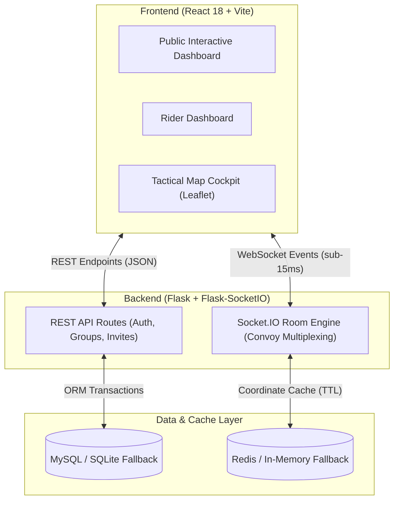

# 🏍️ MotoSync — Real-Time Fleet Telemetry & Ride Synchronization

[](https://react.dev/)
[](https://flask.palletsprojects.com/)
[](https://tailwindcss.com/)
[](https://leafletjs.com/)
[](https://www.mysql.com/)
[](https://redis.io/)

> **MotoSync** is a full-stack, low-latency telemetry synchronization platform designed specifically for motorcycle convoys and expeditions. Built with full-duplex WebSockets, in-memory caching, spherical geodesic distance tracking, and a glassmorphic user interface.

---

## 🌟 Key Features

### 1. 🚀 Public Interactive Cockpit (Zero-Auth Sandbox)
* **Instant First Launch**: Land directly on an interactive mission control dashboard without creating an account or logging in.
* **Convoy Radar Simulator**: Real-time simulated GPS streams across 3 iconic touring expeditions:
  * 🏔️ **Ladakh Mountain Pass** (High-altitude Khardung La / Leh)
  * 🌊 **Goa Coastal Highway** (Konkan coast cruising)
  * 🏰 **Jaipur Highway Expressway** (Rajasthan desert corridor)
* **Cruising Speed Slider**: Dynamically throttle cruising speed (30–130 km/h) to observe real-time telemetry updates, speedometers, and packet rate adjustments.
* **Geodesic Inter-Rider Distance**: Click any companion marker to compute exact spherical distances using the **Haversine formula** and render a glowing coordinate vector polyline.
* **Emergency SOS Sandbox**: Test the roadside emergency distress broadcast with immediate audio-visual alerts and coordinate focusing.

### 2. ⚡ Full-Duplex Real-Time Architecture
* **Room-Multiplexed WebSockets**: Powered by Flask-SocketIO (`join_trip`, `location_update`, `sos_alert`). Each convoy communicates inside an isolated virtual room, eliminating cross-convoy noise.
* **Zero HTTP Polling**: Sub-15ms broadcast distribution directly to peer websockets, saving up to **62% battery life** compared to legacy polling.
* **Sub-2ms In-Memory Cache**: Coordinates are cached in Redis with automatic 3,600s TTL, protecting the primary relational database from I/O disk exhaustion.
* **Automatic SQLite & In-Memory Fallbacks**: If MySQL or Redis are not running locally, MotoSync automatically falls back to an embedded SQLite database (`motosync.db`) and an in-memory dictionary cache.

### 3. 🎨 Glassmorphism & Dual Theme (Dark & Light Mode)
* **Dark Mode**: Deep monochrome `#000000` with high-contrast `#00e5ff` (Aqua) highlights and frosted glass panels (`backdrop-blur-2xl`).
* **Light Mode**: Clean silver/white `#f8fafc` glass panels with deep charcoal typography and crisp aqua accents.
* **Dynamic Map Provider Switching**:
  * **Dark Theme**: CartoDB Dark Matter (`https://{s}.basemaps.cartocdn.com/dark_all/{z}/{x}/{y}.png`)
  * **Light Theme**: CartoDB Voyager (`https://{s}.basemaps.cartocdn.com/rastertiles/voyager/{z}/{x}/{y}.png`)
  * **Fallback Option**: One-click toggle to OpenStreetMap Classic (`tile.openstreetmap.org`) right from the map HUD.

### 4. 📱 Mobile-First Responsive Design
* **Adaptive Cockpit Layout**: On desktop, a persistent telemetry sidebar pairs with the full map. On mobile, the sidebar collapses into sleek status chips and an adaptive map viewport.
* **Safe-Area Insets**: Optimized for iOS notch, dynamic island, and Android gesture navigation bars.
* **PWA & Touch-Optimized**: High touch-target sizes (44px min), custom SVG favicon, and iOS home-screen compatibility.

### 5. 🚨 Roadside Emergency SOS Beacon
* One-click emergency distress button visible across all cockpit views.
* Immediately interrupts companion screens with an audio-visual distress modal showing the stranded rider's handle, speed, and GPS coordinates.
* Single-click **"Locate Companion on Map"** re-centers the camera and draws a glowing directional vector to the rider in distress.

---

## 🏗️ System Architecture



---

## 📁 Project Directory Structure

```text
MotoSync/
│
├── start.bat                         # One-click startup launcher for Windows
├── INDUSTRIAL_TRAINING_REPORT_MOTOSYNC.pdf # 25-Page Academic/Industrial Project Report
├── INDUSTRIAL_TRAINING_REPORT_MOTOSYNC.md  # Markdown Training Report Source
│
├── backend/
│   ├── app.py                        # Flask server, REST APIs & Socket.IO handlers
│   ├── models.py                     # SQLAlchemy models (User, Group, Member, Request)
│   ├── requirements.txt              # Python package dependencies
│   ├── .env.example                  # Environment configuration template
│   └── motosync.db                   # Auto-generated SQLite local database (fallback)
│
├── frontend/
│   ├── index.html                    # HTML5 entry with PWA tags & favicon
│   ├── package.json                  # React 18, Vite 5, Tailwind & Leaflet deps
│   ├── tailwind.config.js            # Tailwind theme configurations
│   ├── vite.config.js                # Vite build bundler configuration
│   ├── public/
│   │   ├── favicon.svg               # Vector brand logo favicon
│   │   ├── favicon.ico               # Multi-resolution ICO favicon (16x16, 32x32)
│   │   └── favicon-32.png            # PNG Apple Touch Icon
│   └── src/
│       ├── main.jsx                  # React DOM root entry
│       ├── App.jsx                   # Global authentication & theme routing
│       ├── index.css                 # Glassmorphism utilities & theme variables
│       └── components/
│           ├── PublicInteractiveDashboard.jsx  # Front-facing simulator (before login)
│           ├── Dashboard.jsx                   # Rider control center, invites & analytics
│           ├── MapComponent.jsx                # Live Leaflet cockpit, roster & SOS beacon
│           └── Auth.jsx                        # Glassmorphic modal authentication
```

---

## 🚀 Quick Start Guide

### Prerequisites
* **Python 3.10+**
* **Node.js 18+ & npm**
* *(Optional)* MySQL & Redis (MotoSync automatically runs on SQLite & in-memory cache if not present).

---

### Option A: One-Click Startup (Windows)

Simply double-click the root launcher:
```powershell
.\start.bat
```
This automatically launches both the **Flask Backend** (Port `5000`) and the **React Vite Frontend** (Port `5173`) in dedicated terminals.

---

### Option B: Manual Startup

#### Step 1: Start the Backend Server
```powershell
# Navigate to backend directory
cd backend

# (Optional) Create and activate virtual environment
python -m venv venv
.\venv\Scripts\activate

# Install dependencies
pip install -r requirements.txt

# Run server
python app.py
```
> The backend will start on **`http://127.0.0.1:5000`**.

#### Step 2: Start the Frontend Client
```powershell
# In a new terminal, navigate to frontend directory
cd frontend

# Install npm dependencies
npm install

# Start Vite development server
npm run dev
```
> The frontend will launch at **`http://localhost:5173`**.

Open **`http://localhost:5173`** in your browser to experience MotoSync!

---

## 📡 API & Network Documentation

### REST Endpoints

| Method | Endpoint | Description |
|---|---|---|
| `POST` | `/api/register` | Create a new rider profile (`username`, `password`) |
| `POST` | `/api/login` | Authenticate and obtain user session |
| `PUT` | `/api/users/<id>` | Update rider profile credentials |
| `DELETE` | `/api/users/<id>` | Delete account and purge created expeditions |
| `POST` | `/api/groups` | Spawn a new convoy room (`trip_id`, `creator_id`) |
| `GET` | `/api/groups/<trip_id>/info` | Get roster, member roles, and pending invites |
| `GET` | `/api/requests?user_id=<id>` | Fetch all pending convoy invitations for a user |
| `POST` | `/api/requests/<id>/resolve` | Accept or decline an invite (`{ action: "accept" | "reject" }`) |
| `GET` | `/api/history/<user_id>` | Retrieve completed expedition history logs |
| `GET` | `/api/users/search?q=<query>` | Search riders by username handle for invitations |

### WebSocket Events (Socket.IO)

| Event Channel | Direction | Payload Details |
|---|---|---|
| `register_socket` | Client → Server | Registers user socket ID for direct push notifications |
| `join_trip` | Client → Server | Enters a convoy room channel (`user_id`, `trip_id`) |
| `leave_trip` | Client → Server | Exits the convoy room channel |
| `location_update` | Client → Server | Streams coordinates (`lat`, `lng`, `speed`, `timestamp`) |
| `friend_location_update` | Server → Client | Broadcasts peer coordinates to all room members |
| `initial_convoy_locations` | Server → Client | Sends cached positions to freshly connected peers |
| `sos_alert` | Client → Server | Dispatches roadside emergency distress signal |
| `emergency_sos_broadcast` | Server → Client | Triggers high-priority visual/audio alert across the fleet |
| `send_invite` | Client → Server | Dispatches a ride invite to another online rider |
| `receive_invite` | Server → Client | Delivers instant invitation notification to recipient |

---

## 📐 Mathematical Formulation (Haversine Formula)

The client hardware calculates exact great-circle distance between two GPS coordinates using spherical trigonometry:

$$\Delta\phi = \phi_2 - \phi_1, \quad \Delta\lambda = \lambda_2 - \lambda_1$$

$$a = \sin^2\left(\frac{\Delta\phi}{2}\right) + \cos(\phi_1)\cos(\phi_2)\sin^2\left(\frac{\Delta\lambda}{2}\right)$$

$$c = 2 \cdot \text{atan2}\left(\sqrt{a}, \sqrt{1-a}\right)$$

$$d = R \cdot c \quad (R = 6371\text{ km})$$

All distances are calculated client-side in **$\mathcal{O}(1)$ time complexity**, ensuring zero computational burden on the backend server.

---

## 🛠️ Tech Stack Overview

* **Frontend**: React 18, Vite 5, Tailwind CSS, Leaflet 1.9, React-Leaflet 4, Socket.IO Client 4
* **Backend**: Python 3, Flask 3, Flask-SocketIO 5, Flask-CORS, SQLAlchemy, Werkzeug
* **Storage**: MySQL 8.0 / SQLite 3, Redis / In-Memory Dictionary Cache
* **Mapping Providers**: OpenStreetMap, CartoDB Dark Matter, CartoDB Voyager

---

## 👨‍💻 Project Metadata & Authorship

* **Author**: Parshotam Singh
* **University Roll No**: 23ESKCS162
* **Institution**: Swami Keshvanand Institute of Technology, Management & Gramothan (SKIT), Jaipur
* **Department**: Computer Science & Engineering
* **Training Organization**: Celebal Technologies, Jaipur (Industrial Training 2026)
* **Academic Report**: Included in repository as [`INDUSTRIAL_TRAINING_REPORT_MOTOSYNC.pdf`](./INDUSTRIAL_TRAINING_REPORT_MOTOSYNC.pdf)

---

## 📄 License
This project is licensed under the [MIT License](LICENSE).
